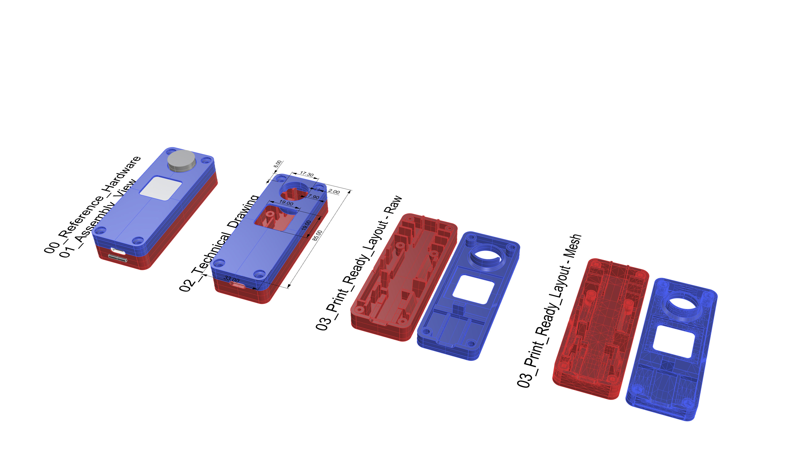
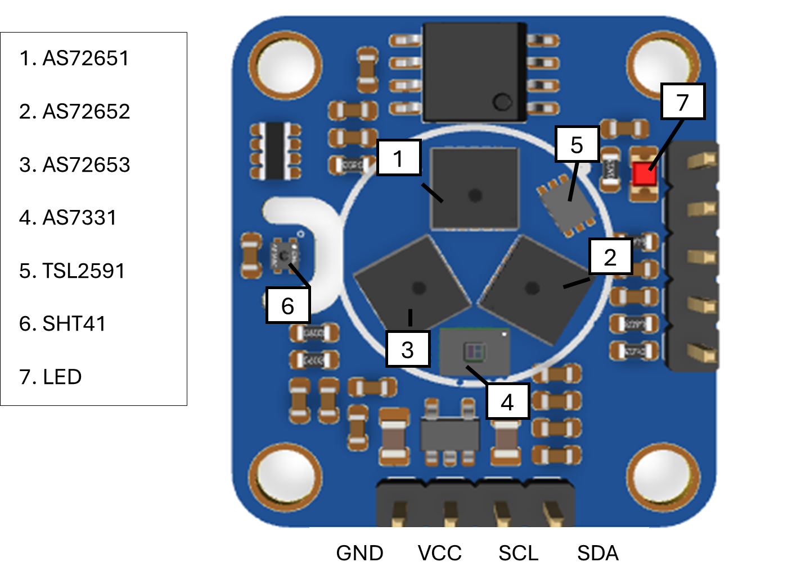

# Hardware Design & Fabrication

This directory contains all necessary assets to fabricate and assemble the physical enclosure and the custom Printed Circuit Board (PCB), camera and microcontroller for the Spatial-Spectral Sensing System. The sensing node is designed for multi-node deployment in indoor environments for comprehensive spatial-spectral light characterization across UV, visible, and near-infrared wavelengths.

## System Overview

The Spatial-Spectral Sensing Node integrates high-resolution multispectral sensing with imaging capabilities to measure:
- **Spectral irradiance** across 18 visible and near-infrared (VIS/NIR) channels
- **Ultraviolet (UV)** exposure across three UV bands (UVA, UVB, UVC)
- **Illuminance**  light exposure and auto-exposure control
- **Color imaging** high-dynamic-range (HDR) for spatial context and reference
- **Temperature monitoring** for thermal compensation of sensor readings

The system is housed in a custom-designed, two-part 3D-printed enclosure optimized for light measurement accuracy and thermal stability.

## Directory Structure

- **`3d_Models/`**: Contains all 3D design and printing files
  - `.3dm`: Native Rhino parametric model for design modifications
  - `.step`: Standard CAD format for cross-platform compatibility
  - `.stl`: Ready-to-print mesh files (multiple configurations)
  
- **`PCB/`**: Contains electronic design and manufacturing documentation
  - `Schematics.pdf`: Complete electrical schematic and component placement
  - `Dimensions.pdf`: PCB physical dimensions and assembly specifications
  - `Image_PCB.png`: Visual reference of the assembled PCB layout
  - `Image_PCB_Labels.png`: Annotated PCB layout with component labels

Content in Rhino file:

## 1. 3D Printed Enclosure

### Design factors

The enclosure is designed to be:
- **Compact & Lightweight**: Minimized footprint enables flexible deployment in various mounting configurations
- **Light-Tight**: Prevents ambient light contamination
- **Optically Precise**: Internal geometry ensures correct positioning and alignment of the cosine diffuser relative to spectral sensors

### Material Specifications

**Primary Material: Black ABS Plastic**
- **Why ABS?**: Superior thermal stability compared to PLA, critical for long-term outdoor/indoor deployment
- **Color**: Black pigment because:
  - Minimize internal light reflections and scattering
  - Prevent ambient light leakage into sensor cavities
  - Ensure accurate spectral measurements
  
**RF Signal Considerations:**
- Carbon-based black pigments (commonly used for ABS) may attenuate Wi-Fi/Bluetooth signals
- Design accommodates external antenna mounting
- Antenna placement should be verified during assembly to match your deployment intent

### 3D Printing Specifications

| Parameter | Value | Rationale |
|-----------|-------|-----------|
| **Material** | Black ABS | Thermal stability and UV resistance |
| **Infill** | 100% | Ensures complete opacity; no light transmission through walls |
| **Layer Height** | 0.12–0.2 mm | Tight tolerances for sensor cavity alignment and diffuser seating |
| **Print Orientation** | See `.3dm` model | Optimized to minimize support material while maintaining critical surface quality |
| **Nozzle Temperature** | 250°C |  ABS extrusion temperature |
| **Build Plate Temp** | 100°C | Prevents warping during cooling |
| **Enclosure** | YES | Needed for ABS print |

### Optical Diffuser Assembly

**Diffuser Specification:**
- **Material**: 1 mm thick PTFE (Polytetrafluoroethylene/Teflon)
- **Purpose**: Creates a cosine-corrected response for measurements
- **Mounting**: Glued flush into the recessed aperture on the inside of `Enclosure_Lid`, directly above the AS7265x sensor array

**Installation Instructions:**
1. Cut PTFE sheet to match the aperture dimensions 19 mm
2. Clean enclosure lid interior surface with isopropyl alcohol
3. Apply a thin, even bead of UV-cured epoxy around the recess perimeter
4. Press PTFE diffuser firmly into place, ensuring flush alignment with the top surface
5. Allow epoxy to cure fully before assembly (use UV-lamp)
6. Verify no air gaps at the perimeter; re-cure if necessary

## 2. Electronics & PCB

### System Integration

The system integrates multiple sensor modalities, camera and a microcontroller to a single module:

### Key Components (Bill of Materials - BOM)

| Component | Model | Purpose | Qty | Notes |
|-----------|-------|---------|-----|-------|
| **Microcontroller** | Seeed XIAO ESP32-S3 | Main processor, wireless connectivity | 1 | Compact module with WiFi/BLE, I2C, DVP |
| **Spectral Sensor** | AMS OSRAM AS7265x | 18-channel VIS/NIR | 1 | Detects 410–940 nm |
| **UV Sensor** | AMS OSRAM AS7331 | 3-channel UV (UVA/UVB/UVC) | 1 | Detects 280–400 nm |
| **Illuminance** | AMSYS TSL2591 | High-dynamic-range light sensor | 1 | Auto-exposure reference |
| **Temperature** | Sensirion SHT41 | Temperature & humidity | 1 | Thermal compensation for light sensors |
| **Camera** | OmniVision OV5640 | 5MP image sensor | 1 | Spatial context and photogrammetry reference |

### PCB Manufacturing

- **Manufacturer**: RTrobot (or equivalent SMT service provider)
- **Assembly Type**: Surface Mount Technology (SMT) for compactness and reliability
- **Communication Interfaces**:
  - I2C Bus (SDA, SCL)
  - Parallel DVP (camera ribbon interface)
  - USB-C (for power and firmware upload)

**Fabrication Files:**
- `PCB/Schematics.pdf` - Detailed electrical schematic with all component values and pinout information
- `PCB/Dimensions.pdf` - Physical layout, trace routing, hole positions, and assembly landmarks
- `PCB/Image_PCB.png` - Rendered photograph showing component placement and labeling for reference

Sensor layout is illustrated below

## 3. Assembly Instructions

### Step 1: Prepare Components
1. Verify all PCB components are present and functioning (continuity test, power-on self-test)
2. Inspect 3D-printed enclosure parts for dimensional accuracy and print quality
3. Clean all internal surfaces with soft brush to remove support material residue and dust

### Step 2: Install Optical Diffuser (Lid)
1. Follow diffuser assembly procedure
2. Verify diffuser is clean and free of fingerprints; wipe with microfiber cloth if needed
3. Confirm flush alignment and if glue is fully cured

### Step 3: Route Cables
1. Thread camera hat ribbon to microcontroller
2. Route cables from microcontroller to PCB (I2C)

### Step 4: Mount components to Base
1. Insert Camera first (wire in channel in enclosure base under PCB), then PCB and controller into the base enclosure, aligning connector positions with cable pass-throughs
2. Press components gently down until it seats on mounting standoffs (you should feel subtle resistance)
3. Verify components is level and not twisted; internal sensors must be properly oriented
4. Ensure no cables are pinched or stressed by sharp edges
5. Use M3 screws for fastening to basemount if necessary
6. Set the WIFI antenna outside of the enclosure

### Step 5: Assemble Enclosure
1. Align lid with base using registration posts
2. Press lid and base together firmly but gently until they seat fully. Recommended: start at the base with the microcontroller
3. Use M3 screws in each corner and fasten

### Step 6: Verification & Testing
1. Connect power and verify all sensors responds
2. Block external light and confirm zero baseline readings (dark reference)
3. Expose to white light source and verify sensor responses
4. Perform spectral calibration using reference light source
5. Test Serial and WiFi/BLE connectivity
6. Verify camera image acquisition and orientation

## Design Files & Source Control

### For Modifications

If you need to modify the enclosure design:

1. Use the Rhino source file (`Source_Enclosure_Design.3dm`)
2. Generate new STL files with appropriate orientation and slicing parameters for your 3D printer
3. Test-print a prototype at reduced scale or with draft settings before committing to final production

### Component References & Datasheets

Links to datasheets and references:
- **AS7265x Spectral Sensor**: [AMS OSRAM Datasheet](https://look.ams-osram.com/m/76ce4c0d80cd1565/original/AS7265x-DS000612.pdf)
- **AS7331 UV Sensor**: [AMS OSRAM Datasheet](https://look.ams-osram.com/m/1856fd2c69c35605/original/AS7331-Spectral-UVA-B-C-Sensor.pdf)
- **TSL2591 Illuminance Sensor**: [AMS OSRAM Datasheet](https://look.ams-osram.com/m/c901de8e97608f8/original/TSL2591-DS000338.pdf)
- **SHT41 Temperature/Humidity**: [Sensirion Datasheet](https://sensirion.com/resource/datasheet/sht4x)
- **OV5640 Camera**: [OmniVision Datasheet](https://cdn.sparkfun.com/datasheets/Sensors/LightImaging/OV5640_datasheet.pdf)
- **XIAO ESP32-S3**: [Seeed Studio Wiki](https://wiki.seeedstudio.com/xiao_esp32s3_getting_started/) / [Espressif Datasheet](https://files.seeedstudio.com/wiki/SeeedStudio-XIAO-ESP32S3/res/esp32-s3_datasheet.pdf)

---
