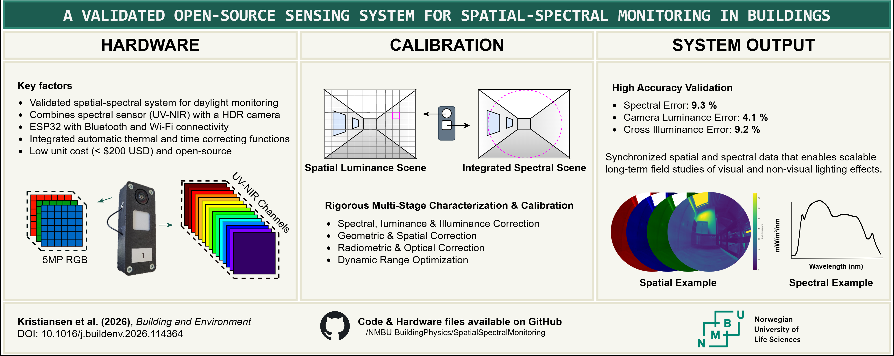
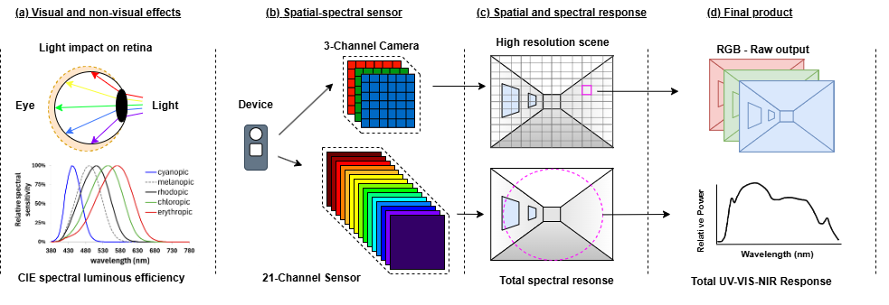

# Spatial-Spectral Sensing System

[](https://www.gnu.org/licenses/gpl-3.0)
[](https://github.com/NMBU-BuildingPhysics/SpatialSpectralMonitoring)
[](https://doi.org/10.1016/j.buildenv.2026.114364)

An open-source, validated sensing system for comprehensive spatial-spectral daylight monitoring in buildings, enabling scalable human-centric light assessment.

> **Associated Publication:** "Enabling scalable, human-centric daylight assessment: A validated open-source sensing system for spatial-spectral monitoring in buildings" by **Kristiansen et al. (2026)** in *Building and Environment*.

[](https://doi.org/10.1016/j.buildenv.2026.114364)


---

## Overview

The **Spatial-Spectral Sensing System** is a complete, validated platform for multi-node deployment in indoor environments. It combines multispectral sensing with high-resolution imaging capabilities to provide comprehensive light characterization across ultraviolet (UV), visible (VIS), and near-infrared (NIR) wavelengths.



> Conceptual overview of the multimodal sensing system's capabilities. **(a)** The system is motivated by the human ocular pathways and the eye's complex spectral sensitivity. **(b)** The instrument is a single device that captures two synchronized data streams: a high-resolution spatial signal from an RGB imager and a low-resolution (single point) with multispectral signal from a 21-channel sensor. **(c)** In a measurement, the imager captures the spatial distribution of light, while the spectral sensor integrates light from its entire field of view. **(d)** This produces a complementary final output: a photometrically accurate high dynamic range (HDR) luminance map and a calibrated absolute spectral irradiance graph for the same scene.


### Key Features

- **21-channel multispectral sensor** with full UV-VIS-NIR coverage (260–940 nm)
  - 18 channels: VIS/NIR spectral sensor (AS7265x: 410–940 nm)
  - 3 channels: UV sensor (AS7331: UVA, UVB, UVC: 280–400 nm)
- **5MP RGB camera** (OV5640) for HDR luminance mapping
- **High-dynamic-range illuminance sensor** (TSL2591) for auto-exposure control
- **Environmental monitoring** (SHT41: temperature & humidity) for thermal compensation
- **Validated accuracy** against reference instrumentation
- **Open-source hardware and software** with complete calibration pipeline

### Technical Stack

- **C/C++** - ESP32-S3 firmware (Arduino framework)
- **Python** - Calibration pipeline and data analysis
- **PowerShell** - Running python scripts

---

## Getting Started

### Hardware Assembly
1. **Fabricate Components**
   - 3D print enclosure parts from [01_Hardware/3d_Models](01_Hardware/3d_Models/)
   - Order PCB assembly from [01_Hardware/PCB](01_Hardware/PCB/) specifications
2. **Assemble System** - Follow the detailed [Hardware Assembly Guide](01_Hardware/README.md)
3. **Test Hardware** - Use utilities in [02_Firmware/Utilities](02_Firmware/Utilities/) to verify sensor communication

### Firmware Setup
1. Install [Arduino IDE](https://www.arduino.cc/en/software) with ESP32 board support
2. Configure Code Dependencies:
   - WiFi credentials in `secrets.h` (copy from `secrets.example.h`).
   - Calibration factors in `calibration.cpp` (copy from `calibration.example.cpp`).
   - Sensor libraries in [02_Firmware/Main/src/sensors](02_Firmware/Main/src/sensors/readme.md)
3. Upload [Main firmware](02_Firmware/Main/) to ESP32-S3
4. Verify data logging via serial monitor

### Calibration Workflow
The complete calibration pipeline is in [03_Python_Suite](03_Python_Suite/). Install Python dependencies with:
```bash
pip install -r 03_Python_Suite/requirements.txt
```

1. **Characterization** (generate models for sensor behavior)
   - [Integration Time Model](03_Python_Suite/01_Characterization/01_Integration_Time_Model/) - Auto-exposure optimization
   - [Thermal Analysis](03_Python_Suite/01_Characterization/02_Thermal_Analysis/) - Temperature compensation
   - [Cosine Correction](03_Python_Suite/01_Characterization/03_Cosine_Correction/) - Angular response validation
   - [Camera Characterization](03_Python_Suite/01_Characterization/04_Camera_Characterization/) - HDR imaging calibration

2. **Absolute Calibration** (derive calibration factors)
   - [Lux Calibration](03_Python_Suite/02_Absolute_Calibration/01_Lux_Calibration/) - Illuminance sensor
   - [Spectral Calibration](03_Python_Suite/02_Absolute_Calibration/02_Spectral_Calibration/) - Multispectral sensors
   - [Camera Calibration](03_Python_Suite/02_Absolute_Calibration/03_Camera_Calibration/) - Luminance mapping

3. **Validation** (verify system performance)
   - [Spectral Validation](03_Python_Suite/03_Validation/01_Spectral_Validation/) - Against reference spectroradiometer
   - [Narrowband Validation](03_Python_Suite/03_Validation/02_Narrowband_Validation/) - Wavelength accuracy
   - [Camera Validation](03_Python_Suite/03_Validation/03_Camera_Validation/) - Luminance accuracy

Each subfolder contains a detailed README with step-by-step instructions.

### Data Collection
Once calibrated, the system automatically:
- Measures spectral irradiance and illuminance at configurable intervals
- Captures HDR image sequences
- Logs environmental data (temperature, humidity)
- Uploads data via WiFi/MQTT/FTP to your server

---

## Project Structure

Each main folder has a dedicated *readme.md* file.

```
SpatialSpectralMonitoring/
├── 01_Hardware/                    # Physical design & fabrication
│   ├── 3d_Models/                 # 3D printable enclosure files (.3dm, .step, .stl)
│   └── PCB/                       # Circuit board schematics & dimensions
│
├── 02_Firmware/                   # ESP32-S3 microcontroller code
│   ├── Main/                      # Production firmware
│   └── Utilities/                 # Hardware testing utilities (Arduino sketches)
│
├── 03_Python_Suite/               # Scientific analysis & calibration
│   ├── 00_Utilities/              # Data management helpers
│   ├── 01_Characterization/
│   │   ├── 01_Integration_Time_Model/  # Auto-exposure model generation
│   │   ├── 02_Thermal_Analysis/        # Temperature compensation model
│   │   ├── 03_Cosine_Correction/       # Angular response correction
│   │   └── 04_Camera_Characterization/ # HDR imaging & vignetting correction
│   ├── 02_Absolute_Calibration/
│   │   ├── 01_Lux_Calibration/         # Illuminance calibration
│   │   ├── 02_Spectral_Calibration/    # Spectral irradiance calibration
│   │   └── 03_Camera_Calibration/      # Camera luminance calibration
│   └── 03_Validation/
│       ├── 01_Spectral_Validation/     # Spectral validation analysis
│       ├── 02_Narrowband_Validation/   # Narrowband validation analysis
│       └── 03_Camera_Validation/       # Camera illuminance & luminance validation
│
└── 04_Documentation/              # Project documentation & images

```

---

## Citation

If you use this system in your research, please cite our work. Citation information is available in the [`CITATION`](CITATION.cff) file or use the "Cite this repository" button on GitHub.

---

## License

This project is licensed under the **GNU General Public License v3.0 (GPL-3.0)**. See [`LICENSE`](LICENSE.md).

You are free to use, modify, and distribute this project, including for commercial purposes, provided that you:
- Preserve copyright notices and license information
- License any derivative works under GPL-3.0
- Make source code and design files available when distributing
- Provide clear attribution to the original authors

**Citation is required for all uses** (see [`CITATION`](CITATION.cff)).

---

## Acknowledgments

This project was developed at the Norwegian University of Life Sciences (NMBU) and is part of an PhD financed by NMBU. 

For more info, check out [NMBU Daylight and Built Environment Research Group](https://www.nmbu.no/en/research/groups/daylight-built-environment)
